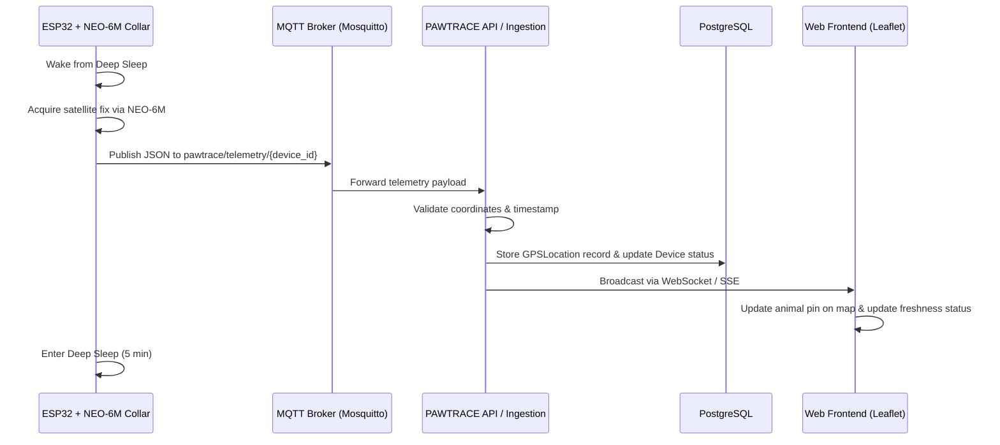

# PAWTRACE Hardware & IoT Architecture
## ESP32 + NEO-6M GPS Collar Integration Guide

---

## 1. Hardware Overview

The PAWTRACE smart collar is an open-source, low-power IoT device designed specifically for animal safety and welfare. It combines an **ESP32 microcontroller** with a **u-blox NEO-6M GNSS GPS module**, rechargeable LiPo battery, and power-management circuitry.

### Component Bill of Materials (BOM)

| Component | Specification | Purpose |
|---|---|---|
| **Microcontroller** | ESP32-WROOM-32D / ESP32-C3 | Processing, Wi-Fi / BLE transmission, power management |
| **GPS Module** | u-blox NEO-6M with ceramic patch | Satellite positioning (lat/lng/altitude/satellites) |
| **Power Source** | 3.7V 800mAh–1200mAh LiPo Battery | Lightweight power |
| **Battery Charger** | TP4056 with over-discharge protection | Micro-USB / Type-C recharging |
| **Collar Strap** | Elastic nylon with breakaway quick-release | Anti-strangulation animal safety mechanism |
| **Enclosure** | 3D-printed PETG or injection-molded ABS | IP67 weatherproof rating |

---

## 2. Wiring & Pinout Diagram

```
+--------------------------------------------------------+
|                      ESP32 DEV BOARD                   |
|                                                        |
|   3V3 -------------------------> NEO-6M VCC            |
|   GND -------------------------> NEO-6M GND            |
|   GPIO 16 (RX2) ---------------> NEO-6M TX             |
|   GPIO 17 (TX2) ---------------> NEO-6M RX             |
|                                                        |
|   GPIO 34 (ADC) <---------------+ [R1: 100k] <-- Battery +
|                                 |                      |
|                                 + [R2: 100k]           |
|                                 |                      |
|                                GND                    GND
+--------------------------------------------------------+
```

---

## 3. Telemetry Pipeline Architecture



---

## 4. Telemetry Payload Format

```json
{
  "device_id": "PT-ESP32-001",
  "latitude": 22.572648,
  "longitude": 88.363912,
  "altitude": 12.5,
  "satellites": 8,
  "timestamp": "2026-11-09T10:30:00Z",
  "battery_level": 85
}
```

---

## 5. Animal Safety Protocols

1. **Breakaway Straps:** Collars MUST use elastic or tension-release clips (opens under >3kg pull) to prevent animals from getting stuck on fences or tree branches.
2. **Weight Limit:** Total collar weight must remain under 40g for cats and 70g for dogs (less than 3% of body weight).
3. **Location Privacy:** The public map deliberately fuzzes coordinates to ~200m to prevent animal abuse, poaching, or illegal capture. Exact coordinates are restricted to verified caretakers.

